# Leoni Maintenance Ticketing System

Application de gestion de tickets de maintenance industrielle, développée durant un stage chez **Leoni** (site de Sousse, Tunisie), accompagnée d'un **pipeline CI/CD complet** sur Azure DevOps : tests automatisés, contrôles qualité et sécurité, conteneurisation Docker, et déploiement continu avec redémarrage automatique.

Le projet a ensuite été étendu à **Kubernetes et GitOps** : chart Helm, cluster k3s local (k3d), images publiées par GitHub Actions dans GHCR, déploiement continu par ArgoCD à partir de Git — voir [Kubernetes & GitOps](#kubernetes--gitops).

## Sommaire

- [Fonctionnalités](#fonctionnalités)
- [Stack technique](#stack-technique)
- [Architecture](#architecture)
- [Base de données, santé et sécurité des conteneurs](#base-de-données-santé-et-sécurité-des-conteneurs)
- [Pipeline CI/CD](#pipeline-cicd)
- [Lancer le projet en local](#lancer-le-projet-en-local)
- [Tests](#tests)
- [Qualité et sécurité](#qualité-et-sécurité)
- [Kubernetes & GitOps](#kubernetes--gitops)
  - [Architecture des deux chaînes de déploiement](#architecture-des-deux-chaînes-de-déploiement)
  - [Résultats mesurés](#résultats-mesurés)
  - [Captures d'écran](#captures-décran)
  - [Démarrer de zéro](#démarrer-de-zéro)
  - [Choix de sécurité](#choix-de-sécurité)
  - [Choix de conception](#choix-de-conception)
  - [Dépannage : problèmes réels rencontrés](#dépannage--problèmes-réels-rencontrés)

## Fonctionnalités

- Création, consultation, mise à jour et suppression de tickets de maintenance (CRUD complet)
- Suivi du statut (Open / InProgress / Resolved / Closed) et de la priorité (Low / Medium / High)
- Filtrage des tickets par statut et par priorité (valeur invalide → erreur 422)
- Tableau de bord statistique en temps réel (tickets ouverts, en cours, priorité haute, délai moyen de résolution)
- Interface visuelle sur mesure, inspirée des cartouches de plans techniques industriels

## Stack technique

| Composant | Technologies |
|---|---|
| Backend | Python 3.13, FastAPI, SQLAlchemy, Pydantic |
| Base de données | SQLite (par défaut) · PostgreSQL (via `DATABASE_URL`) |
| Frontend | React, Vite, Tailwind CSS |
| Tests | pytest, pytest-cov |
| Conteneurisation | Docker (images non-root, build multi-étapes pour le frontend), Docker Compose |
| CI/CD | Azure DevOps Pipelines, agent self-hosted · GitHub Actions |
| Kubernetes & GitOps | k3s (via k3d) · Helm · ArgoCD · Traefik · GitHub Container Registry (GHCR) |
| Qualité & Sécurité | Ruff · Bandit · Gitleaks · Trivy · SonarCloud |

## Architecture

```
┌─────────────┐      HTTP/REST      ┌──────────────┐      SQLAlchemy      ┌──────────────┐
│   React     │ ──────────────────▶ │   FastAPI    │ ───────────────────▶ │  SQLite  ou  │
│  (nginx)    │                     │   (Python)   │                      │  PostgreSQL  │
└─────────────┘                     └──────────────┘                      └──────────────┘
   Conteneur                           Conteneur                          Volume Docker
   Docker                              Docker                             (persistant)
```

Les deux services sont conteneurisés indépendamment et communiquent via une API REST. La base de données est isolée dans un volume Docker dédié, séparé du code applicatif, garantissant la persistance des données entre chaque déploiement.

## Base de données, santé et sécurité des conteneurs

- **Deux bases supportées** : si la variable `DATABASE_URL` est définie (ex. `postgresql+psycopg://...`), le backend utilise PostgreSQL ; sinon il garde SQLite (fichier `DATABASE_PATH`). Le déploiement Azure utilise SQLite ; PostgreSQL sert à la pile Docker Compose locale.
- **Deux endpoints de santé** : `/health` (liveness — le processus répond, sans toucher la base) et `/ready` (readiness — exécute `SELECT 1`, renvoie `503` si la base est injoignable).
- **Images non-root** : le backend tourne avec l'utilisateur `app` (UID 10001, seul `/data` est inscriptible, code en lecture seule) et le frontend avec `nginx-unprivileged` (UID 101, port 8080).

## Pipeline CI/CD

Le pipeline (`azure-pipelines.yml`) se déclenche automatiquement à chaque push et se déroule en deux phases :

**Intégration Continue (CI)**
1. Préparation de l'analyse SonarCloud
2. Installation des dépendances
3. Exécution des tests (couverture de code)
4. Analyse de qualité — Ruff
5. Scan de sécurité du code — Bandit
6. Détection de secrets — Gitleaks
7. Construction des images Docker (backend + frontend)
8. Scan des images — Trivy
9. Analyse et publication — SonarCloud

**Déploiement Continu (CD)** — déclenché uniquement si la CI réussit intégralement
1. Redéploiement du conteneur backend (avec vérification de santé)
2. Redéploiement du conteneur frontend (avec vérification de santé)

L'exécution s'effectue sur un **agent self-hosted**, configuré pour redémarrer automatiquement avec la machine, garantissant que l'application redevient opérationnelle sans intervention manuelle après un redémarrage du poste.

## Lancer le projet en local

### Prérequis
Python 3.13, Node.js 20+, Docker Desktop

### Backend
```bash
cd backend
python -m venv venv
venv\Scripts\activate        # Windows
pip install -r requirements.txt
uvicorn app.main:app --reload
```
L'API est accessible sur `http://127.0.0.1:8000`, documentation interactive sur `/docs`.

### Frontend
```bash
cd frontend
npm install
npm run dev
```
L'interface est accessible sur `http://localhost:5173` (l'URL de l'API vient de `frontend/.env.development`).

### Avec Docker
```bash
docker build -t leoni-maintenance-backend ./backend
docker build -t leoni-maintenance-frontend ./frontend
docker run -d -p 8000:8000 -v leoni-data:/data leoni-maintenance-backend
docker run -d -p 8081:8080 leoni-maintenance-frontend
```
Interface sur `http://localhost:8081`, API sur `http://localhost:8000`. Le frontend non-root écoute sur 8080 dans le conteneur.

### Avec PostgreSQL (Docker Compose)
```bash
cp .env.example .env          # puis remplacer le mot de passe dans .env
docker compose up -d --build
```
Backend sur `http://localhost:8001` (`/ready` vérifie la connexion à PostgreSQL), PostgreSQL sur le port `5433`. Arrêt : `docker compose down` (les données restent dans le volume).

## Tests

```bash
cd backend
pip install -r requirements.txt -r requirements-dev.txt   # outils de test et de qualité
pytest -v --cov=app --cov-report=term-missing
```

Les dépendances sont séparées : `requirements.txt` (exécution, seul fichier installé dans l'image Docker) et `requirements-dev.txt` (pytest, Ruff, Bandit…). Les deux sont générés avec des empreintes SHA-256 par `pip-compile` à partir des fichiers `.in`.

33 tests automatisés (unitaires et d'intégration), 100% de couverture du code applicatif. Chaque test s'exécute sur une base SQLite en mémoire, vide au départ : aucun test ne dépend de l'ordre d'exécution ni des données de développement.

## Qualité et sécurité

| Outil | Rôle |
|---|---|
| **Ruff** | Analyse statique du code Python (style, conventions) |
| **Bandit** | Détection de failles de sécurité dans le code source |
| **Gitleaks** | Détection de secrets dans l'historique Git |
| **Trivy** | Scan des vulnérabilités connues (CVE) dans les images Docker |
| **SonarCloud** | Analyse de qualité globale et calcul du Quality Gate |

## Kubernetes & GitOps

Deuxième chaîne de déploiement, indépendante du pipeline Azure DevOps : l'application
tourne sur un cluster **k3s** local (créé avec k3d), décrite par un **chart Helm** et
déployée par **ArgoCD** à partir de ce dépôt GitHub. Un `git push` de code arrive dans
le cluster **sans aucune commande manuelle**, après des contrôles bloquants.
Le détail des tests et des mesures est dans [`docs/K8S_DEMO.md`](docs/K8S_DEMO.md).

### Architecture des deux chaînes de déploiement

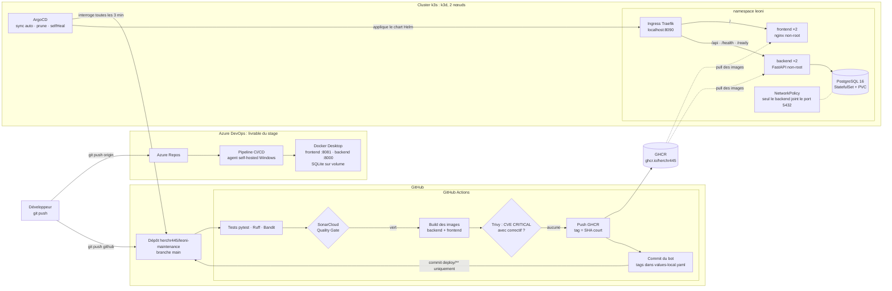

Les deux chaînes partent du même code : `origin` (Azure Repos) alimente le pipeline
Azure DevOps qui déploie sur Docker Desktop ; `github` alimente GitHub Actions et ArgoCD
qui déploient sur Kubernetes. Un Quality Gate rouge ou une CVE CRITICAL corrigeable
arrête la chaîne avant toute publication d'image : rien n'est déployé.

### Résultats mesurés

Mesures réelles sur le cluster local (k3s v1.35.5, 2 nœuds), détaillées dans [`docs/K8S_DEMO.md`](docs/K8S_DEMO.md).

| Test | Résultat |
|---|---|
| Boucle GitOps complète, `git push` → changement visible sur `localhost:8090` | **6 min 48 s – 8 min 09 s** (GitHub Actions ~3,5 min, détection ArgoCD ~3 min, rolling update < 45 s) |
| Rolling updates + rollbacks sous trafic continu | **0 requête en échec sur 904**, latence p99 31 ms (avant correctif : 3 échecs sur 200) |
| Dérive manuelle (`kubectl scale` 2 → 5) | corrigée par ArgoCD en **~2 s** |
| Pod backend supprimé | remplacé et prêt en **6 s**, 150/150 requêtes réussies pendant le test |
| Pod PostgreSQL supprimé | de retour en **5 s**, données identiques (même PVC, même empreinte) |
| `/ready` avec PostgreSQL arrêté | **503 en 7 ms** (médiane), 25 ms au maximum |
| Deux backends démarrés en même temps sur une base vide | **0 redémarrage sur 10 démarrages** (verrou consultatif PostgreSQL) |
| Passage de Helm à ArgoCD | Synced / Healthy en **19 s**, données conservées (même PVC) |
| Page blanche après un déploiement (cache navigateur) | **288 rechargements bloqués → 0** après correctif |
| Contrôles bloquants | une CVE CRITICAL (CVE-2026-111497, brotli) a réellement arrêté un déploiement avant correctif |
| Qualité | 33 tests, 100 % de couverture · Quality Gate SonarCloud vert · Gitleaks : 0 fuite sur tout l'historique |

### Captures d'écran

| | |
|---|---|
|  | 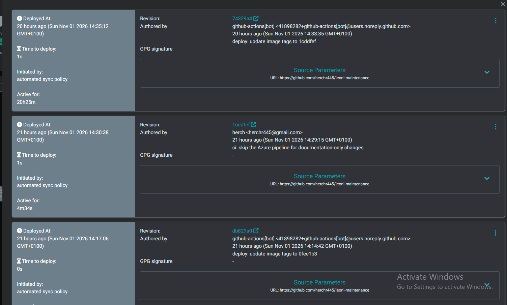 |
| Arbre des ressources ArgoCD (Synced / Healthy) | Historique des synchronisations : un commit du bot par déploiement |
| 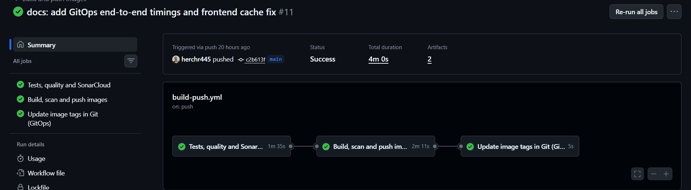 | 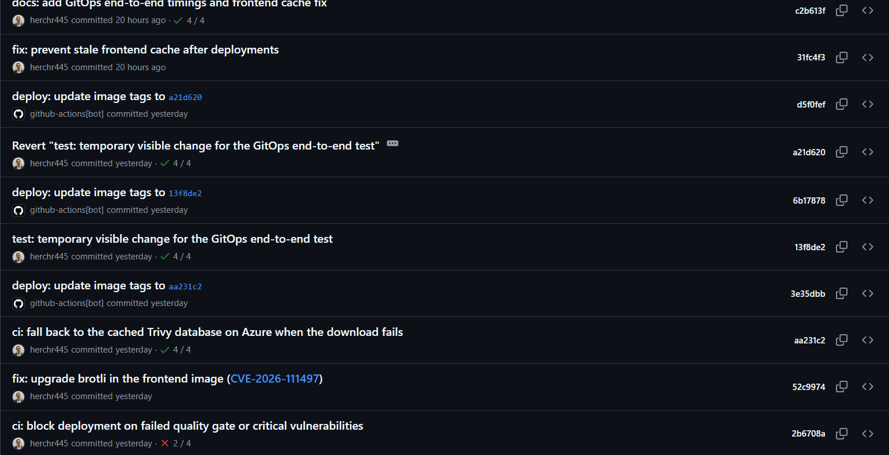 |
| Run GitHub Actions : tests → build → mise à jour des tags | Commits `github-actions[bot]` : « deploy: update image tags to … » |
| 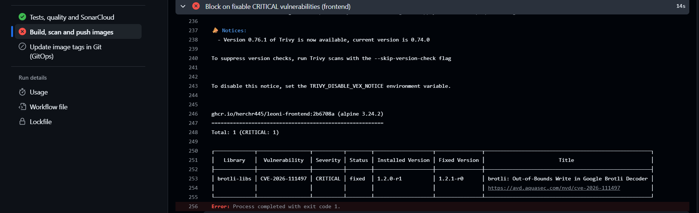 | 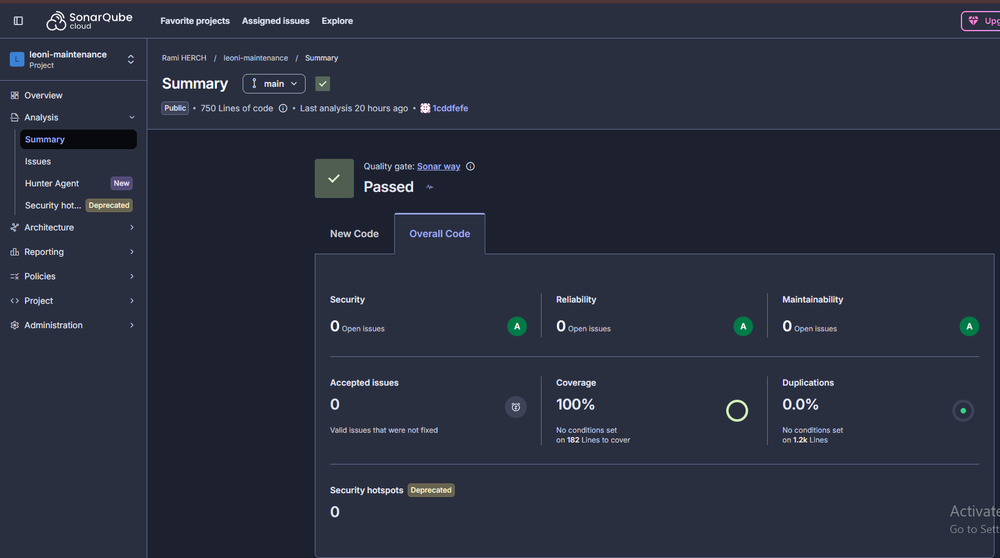 |
| Run arrêté par Trivy (CVE CRITICAL) : rien n'est déployé | Quality Gate SonarCloud : Passed, 100 % de couverture |
| 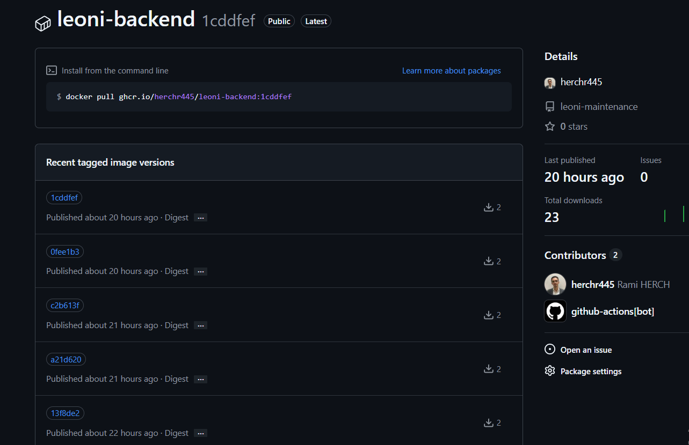 | 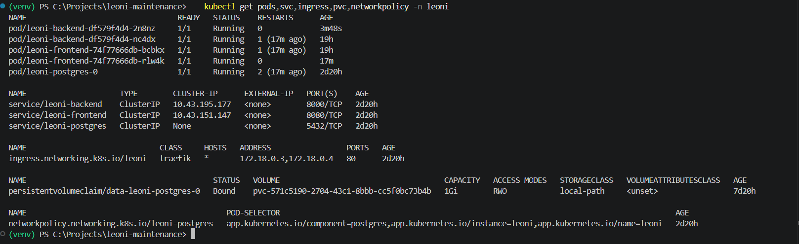 |
| Images publiées dans GHCR, taguées par SHA | `kubectl get pods,svc,ingress,pvc,networkpolicy -n leoni` |
| 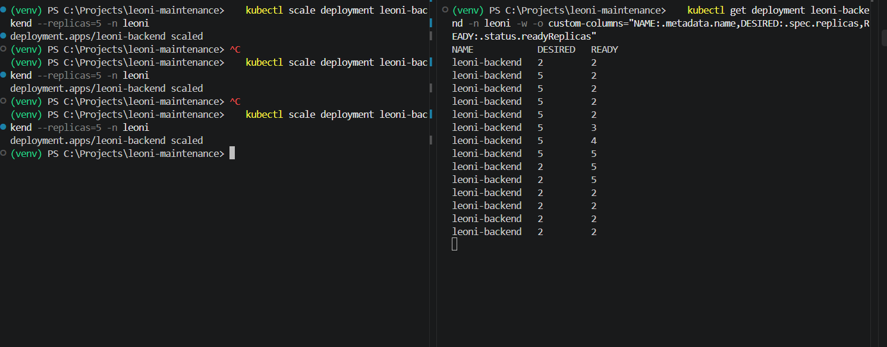 | 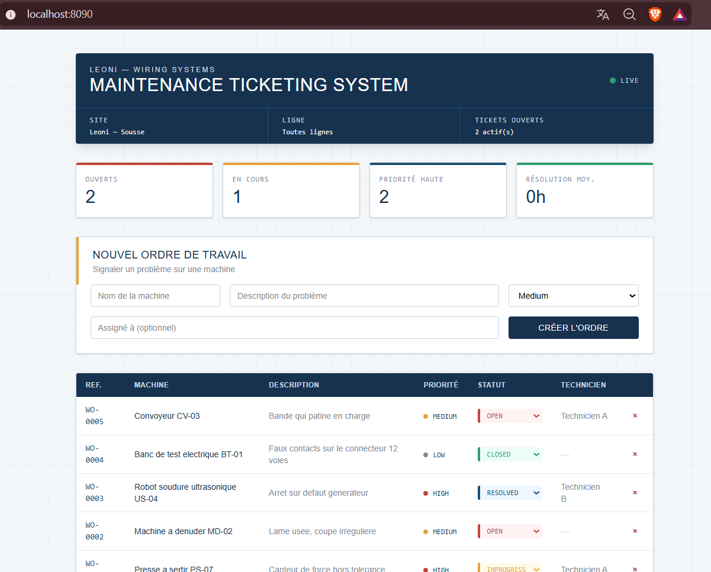 |
| `kubectl scale` à 5 → ArgoCD revient à 2 | L'application servie par le cluster sur `localhost:8090` |
| 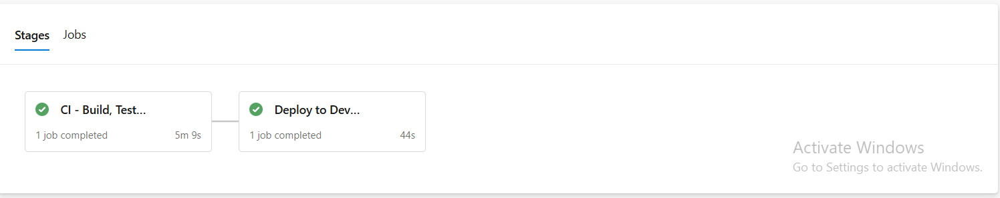 | |
| Pipeline Azure DevOps vert (CI + déploiement Docker Desktop) | |

### Démarrer de zéro

Prérequis : Docker Desktop, `kubectl`, `helm` et `k3d` (installables avec `winget`).

```powershell
# 1. Cluster k3s local : 1 serveur + 1 agent, Ingress Traefik publié sur localhost:8090.
#    L'API est fixée sur 127.0.0.1:6550 (le nom host.docker.internal ne répond pas depuis Windows).
k3d cluster create leoni --agents 1 -p "8090:80@loadbalancer" --api-port 127.0.0.1:6550

# 2. Namespace et Secret de la base (jamais dans Git) — mot de passe : lettres et chiffres uniquement
kubectl create namespace leoni
kubectl create secret generic leoni-db -n leoni --from-literal=password='<mot-de-passe>'

# 3. ArgoCD, version épinglée (application côté serveur : les CRD sont trop volumineuses sinon)
kubectl create namespace argocd
kubectl apply -n argocd --server-side --force-conflicts -f https://raw.githubusercontent.com/argoproj/argo-cd/v3.5.6/manifests/install.yaml

# 4. Application ArgoCD : ArgoCD déploie ensuite le chart deploy/helm/leoni depuis GitHub
kubectl apply -f deploy/argocd/leoni-application.yaml
kubectl get application leoni -n argocd      # attendre Synced / Healthy

# 5. Application : http://localhost:8090 · interface ArgoCD :
kubectl port-forward svc/argocd-server -n argocd 8443:443   # https://localhost:8443, utilisateur admin
```

Ensuite, tout passe par Git : un push sur `main` déclenche tests, Quality Gate, build,
contrôle Trivy, publication dans GHCR et mise à jour des tags par le bot ; ArgoCD
applique le nouveau commit. Pour économiser la mémoire : `k3d cluster stop leoni` /
`k3d cluster start leoni` (données conservées).

### Choix de sécurité

- **Conteneurs non-root** sur les 3 pods (UID 10001, 101 et 70), `readOnlyRootFilesystem`,
  `allowPrivilegeEscalation: false`, toutes les capabilities Linux retirées, profil
  seccomp `RuntimeDefault`, aucun jeton de ServiceAccount monté. Seuls des `emptyDir`
  (`/tmp`, socket PostgreSQL) et le volume de données sont inscriptibles.
- **NetworkPolicy** : seuls les pods backend peuvent joindre PostgreSQL (vérifié : un pod
  de test est bloqué, le backend passe).
- **Secrets hors de Git** : le mot de passe est dans un Secret Kubernetes créé à la main ;
  le chart ne fait que le référencer, et il n'apparaît ni dans les manifestes ni dans
  `kubectl describe`. Gitleaks analyse tout l'historique à chaque build.
- **Chaîne d'approvisionnement** : actions GitHub épinglées par SHA de commit (pas par tag,
  qui peut être déplacé), dépendances Python verrouillées avec empreintes SHA-256
  (`--require-hashes`), images de base épinglées sur une version précise, images
  publiées taguées par SHA (jamais `latest`).
- **Contrôles bloquants** : Quality Gate SonarCloud et CVE CRITICAL corrigeables (Trivy)
  arrêtent le pipeline avant la publication des images.
- **Moindre privilège en CI** : workflow en lecture seule par défaut ; seul le job de
  build peut publier dans GHCR, seul le job de mise à jour des tags peut écrire dans le dépôt.

### Choix de conception

| Choix | Pourquoi |
|---|---|
| **k3d** (k3s dans Docker) | k3s ne tourne pas nativement sous Windows ; k3d crée un vrai cluster k3s certifié avec le Docker Desktop déjà présent, sans coût cloud. Le même chart Helm fonctionnerait sur un cluster managé. |
| **PostgreSQL** dans le cluster | SQLite ne supporte qu'une seule instance de l'API ; PostgreSQL permet 2 répliques du backend et des mises à jour sans coupure. SQLite reste utilisé pour les tests et le déploiement Docker Desktop. |
| **StatefulSet + PVC** en rétention `Retain` | Le volume survit à `helm uninstall`, à `helm upgrade` et au passage de Helm à ArgoCD (vérifié). |
| **GHCR** | Le cluster doit télécharger les images depuis un registre ; GHCR est gratuit pour un dépôt public et lié au dépôt GitHub. |
| **Deux pipelines** | Le pipeline Azure DevOps est le livrable du stage et reste inchangé (déploiement sur le PC) ; GitHub Actions + ArgoCD ajoutent la chaîne Kubernetes. Des filtres de chemins évitent tout déclenchement inutile entre les deux. |
| **Tags d'image dans Git**, mis à jour par un bot | ArgoCD ne déploie que ce que dit Git : le dépôt décrit exactement ce qui tourne, et un retour arrière est un simple `git revert`. |
| **Interrogation périodique** plutôt que webhook | GitHub ne peut pas joindre un cluster qui tourne sur un PC ; ArgoCD interroge donc le dépôt (toutes les 3 min par défaut), ce qui représente environ 45 % du délai de la boucle GitOps. |
| **Verrou consultatif PostgreSQL** plutôt qu'Alembic (pour l'instant) | Supprime la course à la création du schéma entre répliques en quelques lignes, sans nouvelle dépendance. Alembic deviendra utile quand le modèle de données évoluera. |

### Dépannage : problèmes réels rencontrés

| Symptôme | Cause | Correctif |
|---|---|---|
| `kubectl` ne joint pas le cluster k3d (délai dépassé) | k3d écrit `host.docker.internal` dans le kubeconfig ; ce nom pointe vers l'adresse réseau du PC, où le port de l'API ne répond pas | Créer le cluster avec `--api-port 127.0.0.1:6550` |
| `/health` et `/ready` renvoient la page HTML du frontend | Traefik classe les routes par longueur de règle : `Path(/ready)` (14 caractères) perdait contre `PathPrefix(/)` (15) | `pathType: Prefix` pour `/health` et `/ready` |
| `helm upgrade` refusé après un `kubectl scale` | Helm 4 utilise le server-side apply : `kubectl` était devenu propriétaire du champ `.spec.replicas` | `--force-conflicts` ; plus généralement, ne pas modifier à la main ce que gère Git |
| `/ready` mettait 4 à 6 s à répondre 503 quand PostgreSQL était arrêté | Pas de délai de connexion, et le nom court du service mettait 4 s à échouer (requête DNS transmise hors du cluster) | `connect_timeout=3` et nom DNS complet `leoni-postgres.leoni.svc.cluster.local` |
| Un backend pouvait redémarrer au premier lancement | Deux répliques exécutaient `create_all()` en même temps (`UniqueViolation` sur les types ENUM : 10 fois sur 10 dans un test forcé) | `create_all()` sous verrou consultatif PostgreSQL |
| Gitleaks bloque le pipeline Azure sur la clé de projet SonarCloud | Faux positif `generic-api-key` ; sur un clone partiel, il était attribué au dernier commit (empreinte instable) | `.gitleaks.toml` : exception limitée à cette valeur exacte, ce fichier et cette règle |
| Déploiement bloqué : CVE-2026-111497 (CRITICAL) dans `brotli-libs` | Image de base nginx via le tag flottant `alpine`, qui contenait encore la version vulnérable | Base épinglée `1.31.7-alpine3.24` + `apk upgrade brotli-libs` (puis retour à l'UID 101) |
| Pods ArgoCD bloqués en `ContainerCreating`, scan Trivy perdu sur Azure | Connexion lente : images (433 Mo) et base Trivy téléchargées à quelques Ko/s | `k3d image import` depuis le PC ; sur Azure, repli sur la base Trivy en cache avec un avertissement indiquant son âge |
| Page blanche après un déploiement jusqu'à Ctrl+Shift+R | `index.html` sans `Cache-Control` et assets manquants servis en `200 text/html` (repli SPA), mis en cache par le navigateur | `index.html` en `no-cache`, `/assets/*` en `immutable`, asset absent → `404` + `no-store` |

---

*Projet réalisé dans le cadre d'un stage — EPI Digital School, 4ème année Cloud & DevOps.*
